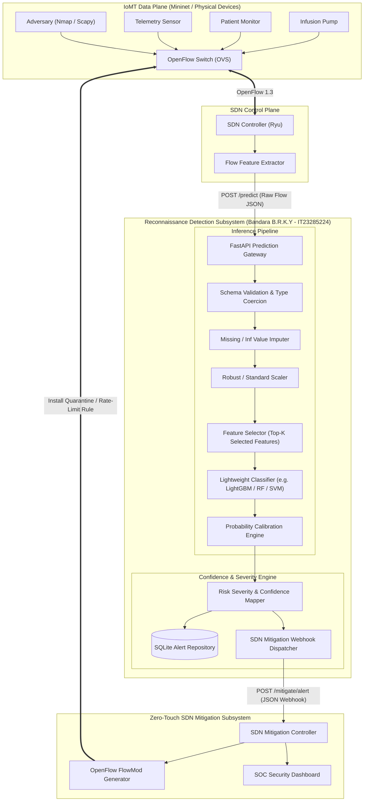
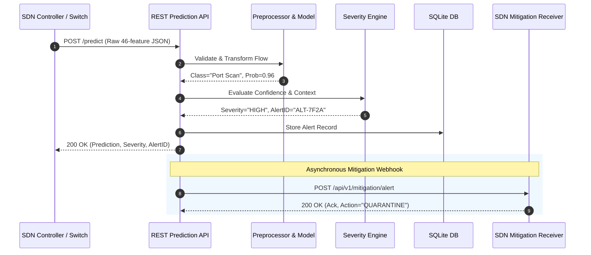

# System Architecture Specification

**Project Title:** Lightweight SDN Intrusion Detection & Zero-Touch Mitigation System for IoMT Networks  
**Individual Component:** Multi-Class Reconnaissance Attack Detection for IoMT Networks  
**Student:** Bandara B.R.K.Y (IT23285224)  

---

## 1. Architectural Overview

The reconnaissance detection component is designed as an autonomous, decoupled microservice operating adjacent to the Software-Defined Networking (SDN) control plane. It processes raw statistical network flow features, executes a leakage-free preprocessing and feature-reduction pipeline, generates calibrated multi-class inferences, maps risk severity, persists alerts, and dispatches structured event webhooks to the SDN zero-touch mitigation controller.

---

## 2. Component Decomposition

### 2.1 Layer 1: Data Ingestion & Validation (`src/data/`)
- **`schema.py`**: Defines the authoritative 46-feature schema of CICIoMT2024, data types, value ranges, and target class taxonomy.
- **`loader.py`**: High-performance streaming reader with chunked processing capable of handling multi-gigabyte raw CSV archives without memory exhaustion.
- **`manifest.py`**: Generates and checks dataset provenance, SHA-256 integrity hashes, sample counts, and version manifests.

### 2.2 Layer 2: Feature Engineering & Preprocessing (`src/features/`)
- **`preprocessor.py`**: Encapsulates imputation, infinite-value clamping, normalization, and scaling within a Scikit-Learn compatible transformer fitted exclusively on training sets.
- **`selector.py`**: Implements Mutual Information (MI), Chi-Square ($\chi^2$), Embedded Tree Importance, and Recursive Feature Elimination (RFE) to isolate the top-$K$ most discriminative features (e.g., $K \in \{5, 10, 15, 20, 30\}$).
- **`leakage.py`**: Automated audit module asserting that duplicate flows, capture session IDs, timestamps, or target labels never cross training and evaluation partitions.

### 2.3 Layer 3: Classifier Models & Baselines (`src/models/`)
- **`classifiers.py`**: Factory and model wrappers for 6 classifiers:
  1. Decision Tree (DT)
  2. Logistic Regression (LR)
  3. Linear Support Vector Machine (Linear SVM)
  4. Random Forest (RF)
  5. XGBoost
  6. LightGBM
- **`baselines.py`**:
  - Baseline A: Full-Feature Multi-Class (45 features)
  - Baseline B: Reduced-Feature Multi-Class (Top-$K$ features)
  - Baseline C: Binary Classification (Benign vs. Recon)
  - Baseline D: Hierarchical Classification (Stage 1: Binary $\to$ Stage 2: 4 Subtypes)
- **`calibration.py`**: Platt scaling and Isotonic regression calibrators ensuring output probabilities represent true empirical risk.

### 2.4 Layer 4: Evaluation & Deployment Profiling (`src/evaluation/`)
- **`metrics.py`**: Computes Macro-F1, Weighted-F1, per-class Precision/Recall/F1, False Positive Rate (FPR), and multiclass confusion matrices.
- **`profiler.py`**: Measures serialized model disk footprint (KB/MB), median/P95 single-flow inference latency, throughput (flows/sec), and runtime CPU/RAM utilization via `psutil`.
- **`scorecard.py`**: Evaluates models against the multi-criteria deployment scorecard to designate the Pareto-optimal model.

### 2.5 Layer 5: REST Prediction Service (`src/api/`)
- **FastAPI Core**: Asynchronous API endpoints with Pydantic request/response validation.
  - `GET /health`: Liveness probe and uptime monitor.
  - `GET /model/info`: Loaded model metadata, version, parameters, and input feature order.
  - `GET /features`: Expected feature names, types, and descriptions.
  - `POST /predict`: Single flow inference with confidence and severity.
  - `POST /predict/batch`: High-throughput batch inference.
  - `GET /alerts`: Query persisted alerts with optional filters.
  - `GET /metrics`: Prometheus-compatible or JSON latency and resource counters.

### 2.6 Layer 6: Confidence-Aware Alerting (`src/alerts/`)
- **`engine.py`**: Computes severity levels (`LOW`, `MEDIUM`, `HIGH`, `CRITICAL`) using a rule matrix combining predicted class, probability confidence, and target criticality.
- **`repository.py`**: Abstract repository interface backed by a local SQLite database for immutable alert audit trails.

### 2.7 Layer 7: SDN Integration & Mock Controller (`src/integration/`)
- **`sdn_client.py`**: Asynchronous HTTP webhook client with exponential backoff, timeout handling, and deduplication.
- **`mock_controller.py`**: Independent FastAPI receiver simulating the OpenFlow mitigation controller for verification.

---

## 3. Data Flow & Sequence Diagram

---

## 4. Software Boundaries & Trust Zones

1. **Untrusted Zone:** Network switches, host endpoints, and raw packet captures.
2. **Analysis Zone (Reconnaissance IDS Service):** Validates raw flow features, isolates compute load, enforces stateless model execution.
3. **Control Zone (SDN Mitigation Controller):** Receives verified, structured alerts and translates high-severity alerts into OpenFlow `FlowMod` rules.
