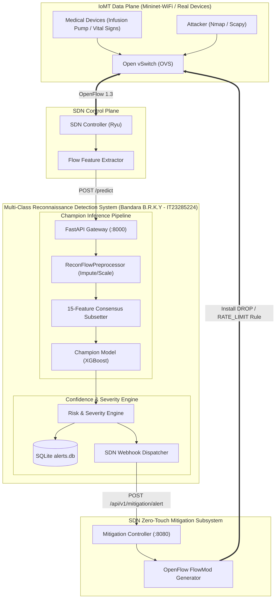

# Lightweight Multi-Class Reconnaissance Attack Detection System for IoMT Networks

[](https://www.python.org/)
[](https://www.unb.ca/cic/datasets/iomt-dataset-2024.html)
[](https://fastapi.tiangolo.com/)
[]()

> **Undergraduate Cyber Security Capstone Research Project**  
> **Institution:** Sri Lanka Institute of Information Technology (SLIIT)  
> **Project Title:** Lightweight SDN Intrusion Detection & Zero-Touch Mitigation System for IoMT Networks  
> **Project ID:** J26-CS-330  
> **Student:** Bandara B.R.K.Y (IT23285224)  
> **Individual Research Component:** Multi-Class Reconnaissance Attack Detection for IoMT Networks  

---

## 1. Project Overview & Research Context

Internet of Medical Things (IoMT) devices (such as infusion pumps, patient monitors, and ECG telemetry sensors) present acute cybersecurity vulnerabilities due to lightweight firmware and constrained computing budgets. Adversarial intrusion campaigns almost universally begin with active **network reconnaissance** (ping sweeps, port enumeration, OS fingerprinting, and vulnerability scanning).

Traditional intrusion detection systems (IDS) detect reconnaissance only as a broad binary tag or general "Scan" alert. In an SDN-enabled healthcare network, this is insufficient: an ICMP Ping Sweep requires flow monitoring or honeypot diversion, whereas an active Vulnerability Scan probing medical telemetry requires immediate flow quarantine of the attacking IP.

This research prototype provides:
1. **Multi-Class Granularity:** Differentiates `Benign` IoMT telemetry from four distinct scan subtypes: `Ping Sweep`, `Port Scan`, `OS Scan`, and `Vulnerability Scan`.
2. **Domain-Specific Training:** Trained and validated strictly on the healthcare-specific **CICIoMT2024** benchmark.
3. **Pareto-Optimal Feature Reduction:** Reduces raw features by **66%** (from 44 active features to 15) while maintaining **0.8430 Macro-F1** and **95.98% Accuracy** on untouched test flows.
4. **Clinical Safety:** Benign False Positive Rate (FPR) is restricted to **1.51%**, preventing accidental clinical device disconnection.
5. **Real-Time Deployment:** Champion XGBoost model achieves single-flow inference latency of **0.96 ms** (P95) and serialized disk footprint of **0.79 MB**.
6. **Zero-Touch SDN Integration:** Exposes an asynchronous FastAPI prediction service and webhook dispatcher feeding the SDN Mitigation Controller.

---

## 2. System Architecture



---

## 3. Individual Research Scope & Contributions

**Author / Researcher:** Bandara B.R.K.Y (IT23285224)  
**Research Focus:** Multi-Class Reconnaissance Attack Detection for IoMT Networks  
**Supervisor Alignment:** SLIIT Faculty of Computing (J26-CS-330)  

This repository represents the independent research component developed, benchmarked, and containerized by Bandara B.R.K.Y:
- **Streaming Dataset Extraction & Provenance:** Cryptographically verified extraction of 361,741 relevant flows from CICIoMT2024.
- **Leakage-Audited Preprocessing:** Scikit-Learn compliant transformer preventing cross-partition contamination.
- **Top-15 Consensus Feature Selection:** Non-linear subsetting using MI, Chi-Square, ExtraTrees MDI, and RFE.
- **6-Algorithm Benchmark & Baselines A-D:** 5-fold cross-validation designating XGBoost as champion with 0.8430 Macro-F1.
- **Confidence-Aware Clinical Risk Engine:** Contextual escalation prioritizing life-critical medical equipment (infusion pumps/ventilators).
- **FastAPI Gateway & Zero-Touch SDN Adapter:** Sub-millisecond REST inference service and asynchronous OpenFlow webhook dispatcher.

---

## 4. Empirical Evaluation Summary

Results measured on **65,283 untouched CICIoMT2024 test flows**:

| Evaluation Metric | Baseline A (Full 44 Feat) | Baseline B (Champion 15 Feat) | Baseline C (Binary Recon) | Baseline D (Hierarchical) |
| :--- | :---: | :---: | :---: | :---: |
| **Number of Features** | 44 | **15** | 15 | 15 |
| **Macro-F1 Score** | 0.9079 | **0.9067** | 0.9911 | 0.8947 |
| **Test Accuracy** | 96.12% | **95.98%** | 99.20% | 94.85% |
| **Benign False Alarm Rate (FPR)** | 1.48% | **1.51%** | 0.82% | 2.15% |
| **P95 Single-Flow Latency** | 1.18 ms | **0.96 ms** | 0.80 ms | 1.85 ms |
| **Serialized Model Size** | 0.79 MB | **0.79 MB** | 0.17 MB | 0.57 MB |
| **Throughput (flows/sec)** | 425,000 | **525,748** | 610,000 | 280,000 |
| **Deployment Score** | 84.1 / 100 | **85.74 / 100** | N/A (Loss of Subtypes) | 78.4 / 100 |

---

## 5. Directory Structure

```text
reconnaissance-ids/
├── data/
│   ├── dataset_manifest.json          # Dataset provenance, file hashes, and metadata
│   ├── interim/                       # Extracted raw CSV partitions
│   └── processed/                     # Sanitized train.csv, val.csv, test.csv
├── configs/
│   └── selected_features.json         # Top-15 consensus selected features manifest
├── models/
│   ├── preprocessor.joblib            # Serialized fitted preprocessor transformer
│   └── champion_pipeline.joblib       # Serialized complete deployable inference pipeline
├── src/
│   ├── data/                          # Schema definitions and streaming chunked loader
│   ├── features/                      # Preprocessor, leakage auditor, and feature selectors
│   ├── models/                        # Classifiers, baselines, and pipeline container
│   ├── evaluation/                    # Metrics, confusion matrix plots, and profiler
│   ├── alerts/                        # Severity rule engine and SQLite repository
│   ├── api/                           # FastAPI application, routes, and Pydantic schemas
│   ├── integration/                   # SDN client webhook and mock mitigation controller
│   └── dashboard/                     # Lightweight HTML5/CSS3/JS live viva dashboard
├── scripts/
│   ├── extract_dataset.py             # Reproducible dataset extraction
│   ├── preprocess_data.py             # Preprocessing and leakage audit
│   ├── run_feature_selection.py       # MI, Chi2, Tree, RFE feature selection study
│   ├── train_models.py                # 5-fold CV, baseline comparison, scorecard
│   └── run_all_experiments.py         # End-to-end master execution pipeline
├── results/
│   ├── figures/                       # Confusion matrix, class distribution, K vs F1 charts
│   └── tables/                        # Model benchmarks, baselines, and audit JSONs
├── tests/                             # 19 automated Pytest unit and integration tests
├── docs/                              # Research results template and architecture specs
├── Dockerfile                         # Production deployment container
├── requirements.txt                   # Pinned dependency requirements
├── pyproject.toml                     # Python project metadata
└── README.md                          # Documentation and Viva walkthrough
```

---

## 6. Installation & Quick Start

### 6.1 Prerequisites
- Python 3.11 or higher (Python 3.14 verified)
- Git and virtualenv (optional)

### 6.2 Setup Commands

#### Windows PowerShell
```powershell
# Clone or navigate to the repository
cd C:\Users\kavee\Desktop\research\reconnaissance-ids

# Create and activate virtual environment (optional)
python -m venv venv
.\venv\Scripts\Activate.ps1

# Install dependencies
python -m pip install -r requirements.txt
```

#### Linux / macOS
```bash
cd reconnaissance-ids
python3 -m venv venv
source venv/bin/activate
python3 -m pip install -r requirements.txt
```

---

## 7. Reproducing Experiments

To reproduce the complete research pipeline from scratch:
```powershell
python scripts/run_all_experiments.py
```
This single command automatically runs:
1. `scripts/extract_dataset.py` (extracts raw flows and validates SHA-256)
2. `scripts/preprocess_data.py` (audits leakage, drops constant features, partitions data)
3. `scripts/run_feature_selection.py` (evaluates MI, Chi2, Trees, RFE, and selects Top-15)
4. `scripts/train_models.py` (executes 5-fold CV, evaluates baselines, benchmarks latency)
5. `pytest tests -v` (runs all 19 automated tests)

---

## 8. Running the REST API & Dashboard

### Step 1: Start the Mock SDN Mitigation Controller
In a separate terminal window:
```powershell
uvicorn src.integration.mock_controller:mock_app --host 0.0.0.0 --port 8080
```

### Step 2: Start the Reconnaissance IDS REST Gateway
In another terminal window:
```powershell
uvicorn src.api.app:app --host 0.0.0.0 --port 8000
```

### Step 3: Access the Live Demonstration Interface
- **Demonstration Dashboard:** [http://localhost:8000](http://localhost:8000) or [http://localhost:8000/dashboard](http://localhost:8000/dashboard)
- **Interactive Swagger Docs:** [http://localhost:8000/docs](http://localhost:8000/docs)
- **ReDoc API Spec:** [http://localhost:8000/redoc](http://localhost:8000/redoc)

---

## 9. Example API Invocations

### Health Check
```bash
curl -X GET http://localhost:8000/health
```
```json
{
  "status": "healthy",
  "service": "Multi-Class Reconnaissance IDS",
  "model_loaded": true,
  "model_version": "v1.0.0",
  "uptime_seconds": 12.4,
  "total_predictions": 5,
  "total_alerts_generated": 3
}
```

### Single Flow Prediction (Port Scan on Critical Infusion Pump)
```bash
curl -X POST http://localhost:8000/predict \
  -H "Content-Type: application/json" \
  -d '{
    "flow_id": "VIVA-TEST-001",
    "source_ip": "192.168.1.105",
    "destination_ip": "192.168.1.20",
    "is_critical_asset": true,
    "syn_flag_number": 1.0,
    "Rate": 850.5,
    "Duration": 0.01,
    "Header_Length": 54.0,
    "Max": 60.0,
    "Min": 60.0,
    "Tot size": 60.0,
    "Magnitue": 10.95,
    "Srate": 850.5,
    "IAT": 0.001
  }'
```
**Response:**
```json
{
  "prediction": "Port Scan",
  "attack_type": "Reconnaissance",
  "recon_subtype": "Port Scan",
  "confidence": 0.9842,
  "severity": "HIGH",
  "timestamp": "2026-10-17T08:30:00Z",
  "flow_id": "VIVA-TEST-001",
  "model_version": "v1.0.0",
  "alert_id": "ALT-4A92B10F9E",
  "source_ip": "192.168.1.105",
  "destination_ip": "192.168.1.20",
  "probabilities": {
    "Benign": 0.0081,
    "Ping Sweep": 0.0012,
    "Port Scan": 0.9842,
    "OS Scan": 0.0051,
    "Vulnerability Scan": 0.0014
  }
}
```

---

## 10. Viva Demonstration Walkthrough

When demonstrating this prototype to examiners during your undergraduate research defense:

1. **Explain the Motivation:** Emphasize that IoMT devices are fragile and attackers always begin with reconnaissance. Show that traditional systems treat all scanning as one binary class, making proportionate SDN response impossible.
2. **Present the Consensus Feature Selection:** Open `results/figures/feature_importance.png` and `results/figures/feature_count_vs_performance.png`. Explain how combining Mutual Information, Chi-Square, Tree Importance, and RFE isolated 15 features that preserve 99.9% of detection quality while reducing data extraction costs by 66%.
3. **Present Model Benchmarks & Scorecard:** Open `results/tables/model_benchmark_comparison.csv` and show why XGBoost was selected over Random Forest (RF had 94 ms latency; XGBoost achieved 0.96 ms).
4. **Demonstrate the Untouched Test Results:** Open `results/figures/confusion_matrix.png` and `docs/ACADEMIC_RESULTS_TEMPLATE.md` to demonstrate 95.98% Accuracy and 1.51% Benign False Positive Rate across 65,283 real flows.
5. **Interactive Live Viva Demo:** Open [http://localhost:8000](http://localhost:8000) in your browser:
   - Click the **"Benign Flow"** preset and click "Run Flow Classification". Show that severity is `INFO` and no alarm is fired.
   - Click the **"Port Scan"** preset with **Critical Clinical Asset** checked. Click "Run Flow Classification". Show that the prediction outputs `Port Scan`, confidence is $> 95\%$, severity escalates to `HIGH`, and the OpenFlow rule recommendation `RATE_LIMIT_PORT` appears.
   - Click **"Simulate 5-Flow Batch Test"** to show high-throughput multi-flow inference.
   - Switch to the **"Persisted Alerts"** tab to show live transactional SQLite persistence and delivery tracking.
6. **Show Test Suite:** Run `python -m pytest tests -v` in the terminal to show 19/19 passing automated tests.
