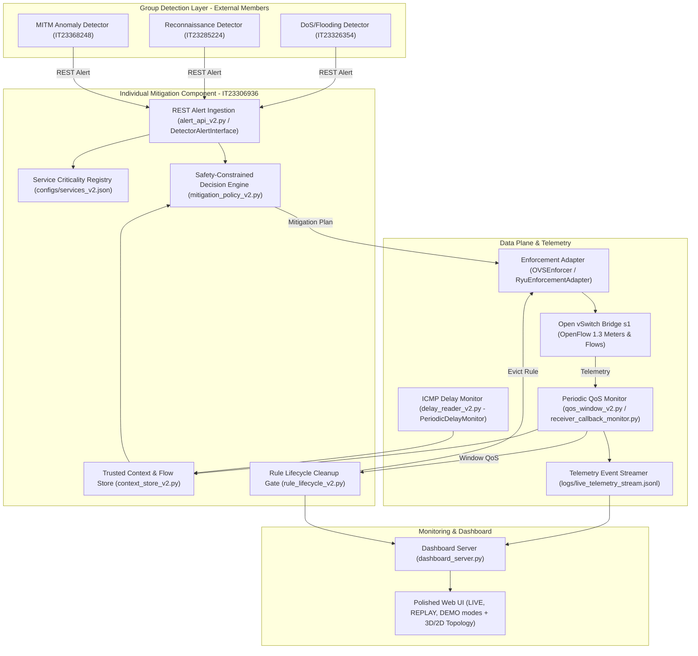

# IoMT Adaptive SDN Mitigation & Monitoring — System Runbook (Rev 5)
**Project Code:** J26-CS-330  
**Student Name:** H.M.S.H. Wijerathna (IT23306936)  
**Component:** Safety-Constrained Adaptive SDN Mitigation and Monitoring for IoMT Networks  

---

## 1. System Architecture



---

## 2. Environments and Directories

| Purpose | Location |
|:---|:---|
| **Windows Development Host** | `C:\IoMT_Backup\extracted\iomt-research` |
| **Shared Windows Drive on VM** | `/mnt/windows_backup/extracted/iomt-research` |
| **Ubuntu Linux VM Project** | `/home/sahan/iomt-review-20261013-101743` |
| **Ubuntu Python Environment** | `/home/sahan/iomt-research/.venv/bin/python` |

---

## 3. Synchronization (Windows &rarr; Ubuntu VM)

Whenever code changes are made on Windows, run these commands in the **Ubuntu VM Terminal**:

```bash
# 1. Create a timestamped backup of the current VM files
BACKUP_DIR="/home/sahan/iomt-review-20261013-101743/backup_$(date +%Y%m%d_%H%M%S)"
mkdir -p "$BACKUP_DIR/tests" "$BACKUP_DIR/static/css" "$BACKUP_DIR/static/js" "$BACKUP_DIR/templates"
cp -v /home/sahan/iomt-review-20261013-101743/comparison_runner.py "$BACKUP_DIR/" 2>/dev/null || true
cp -v /home/sahan/iomt-review-20261013-101743/dashboard_server.py "$BACKUP_DIR/" 2>/dev/null || true
cp -v /home/sahan/iomt-review-20261013-101743/controller_detector_interfaces.py "$BACKUP_DIR/" 2>/dev/null || true
cp -v /home/sahan/iomt-review-20261013-101743/telemetry_contract.py "$BACKUP_DIR/" 2>/dev/null || true
cp -v /home/sahan/iomt-review-20261013-101743/tests/test_units.py "$BACKUP_DIR/tests/" 2>/dev/null || true
cp -v /home/sahan/iomt-review-20261013-101743/tests/test_dashboard_integrity.py "$BACKUP_DIR/tests/" 2>/dev/null || true

# 2. Copy the updated source, contract, tests, and frontend
cp -v /mnt/windows_backup/extracted/iomt-research/comparison_runner.py /home/sahan/iomt-review-20261013-101743/
cp -v /mnt/windows_backup/extracted/iomt-research/controller_detector_interfaces.py /home/sahan/iomt-review-20261013-101743/
cp -v /mnt/windows_backup/extracted/iomt-research/telemetry_contract.py /home/sahan/iomt-review-20261013-101743/
cp -v /mnt/windows_backup/extracted/iomt-research/dashboard_server.py /home/sahan/iomt-review-20261013-101743/
cp -v /mnt/windows_backup/extracted/iomt-research/TELEMETRY_SCHEMA.md /home/sahan/iomt-review-20261013-101743/
cp -v /mnt/windows_backup/extracted/iomt-research/requirements_matrix.md /home/sahan/iomt-review-20261013-101743/
cp -v /mnt/windows_backup/extracted/iomt-research/RUNBOOK.md /home/sahan/iomt-review-20261013-101743/

# Copy tests
cp -v /mnt/windows_backup/extracted/iomt-research/tests/test_units.py /home/sahan/iomt-review-20261013-101743/tests/
cp -v /mnt/windows_backup/extracted/iomt-research/tests/test_dashboard_integrity.py /home/sahan/iomt-review-20261013-101743/tests/

# Copy frontend templates and assets
mkdir -p /home/sahan/iomt-review-20261013-101743/static/css /home/sahan/iomt-review-20261013-101743/static/js /home/sahan/iomt-review-20261013-101743/templates
cp -v /mnt/windows_backup/extracted/iomt-research/templates/index.html /home/sahan/iomt-review-20261013-101743/templates/
cp -v /mnt/windows_backup/extracted/iomt-research/static/css/dashboard.css /home/sahan/iomt-review-20261013-101743/static/css/
cp -v /mnt/windows_backup/extracted/iomt-research/static/js/dashboard.js /home/sahan/iomt-review-20261013-101743/static/js/
cp -v /mnt/windows_backup/extracted/iomt-research/static/js/topology_3d.js /home/sahan/iomt-review-20261013-101743/static/js/

# 3. Verify SHA256 checksums
sha256sum /mnt/windows_backup/extracted/iomt-research/comparison_runner.py /home/sahan/iomt-review-20261013-101743/comparison_runner.py
sha256sum /mnt/windows_backup/extracted/iomt-research/dashboard_server.py /home/sahan/iomt-review-20261013-101743/dashboard_server.py
sha256sum /mnt/windows_backup/extracted/iomt-research/telemetry_contract.py /home/sahan/iomt-review-20261013-101743/telemetry_contract.py
sha256sum /mnt/windows_backup/extracted/iomt-research/controller_detector_interfaces.py /home/sahan/iomt-review-20261013-101743/controller_detector_interfaces.py
sha256sum /mnt/windows_backup/extracted/iomt-research/tests/test_units.py /home/sahan/iomt-review-20261013-101743/tests/test_units.py
sha256sum /mnt/windows_backup/extracted/iomt-research/tests/test_dashboard_integrity.py /home/sahan/iomt-review-20261013-101743/tests/test_dashboard_integrity.py
```

---

## 4. Test Suite Execution

### In Windows PowerShell:
```powershell
cd C:\IoMT_Backup\extracted\iomt-research
python -m pytest tests/
```

### In Ubuntu VM Terminal:
```bash
cd /home/sahan/iomt-review-20261013-101743
/home/sahan/iomt-research/.venv/bin/python -m pytest -v tests/
```
*(Expected: 163 passed)*

---

## 5. Starting the Dashboard

### On Windows Development Host:
```powershell
cd C:\IoMT_Backup\extracted\iomt-research
python dashboard_server.py
```
Open browser to: `http://127.0.0.1:5000`

### On Ubuntu Linux VM:
```bash
cd /home/sahan/iomt-review-20261013-101743
/home/sahan/iomt-research/.venv/bin/python dashboard_server.py
```
- From Ubuntu browser: `http://localhost:5000`
- From Windows browser via SSH tunnel:
  ```cmd
  ssh -L 5000:localhost:5000 sahan@<VM_IP>
  ```
  Then browse to `http://localhost:5000` on Windows.

---

## 6. Live Mininet Experiment Commands (Ubuntu VM Terminal)

> [!IMPORTANT]
> Live Mininet experiments require Linux root privileges and an active Open vSwitch kernel module. Never run as mock when testing live.

### 1-Repeat Live Smoke Run (All 3 Scenarios: Baseline, Static Block, Adaptive):
```bash
cd /home/sahan/iomt-review-20261013-101743
sudo PYTHONPATH=/usr/lib/python3/dist-packages /home/sahan/iomt-research/.venv/bin/python comparison_runner.py --live --repeats 1 --scenario all
```

### 1-Repeat Live Individual Scenario Runs:
```bash
# Baseline only (Unmitigated 5 Mbit/s DoS vs 100 kbps ECG):
sudo PYTHONPATH=/usr/lib/python3/dist-packages /home/sahan/iomt-research/.venv/bin/python comparison_runner.py --live --repeats 1 --scenario baseline

# Static blocking only (Drop rule):
sudo PYTHONPATH=/usr/lib/python3/dist-packages /home/sahan/iomt-research/.venv/bin/python comparison_runner.py --live --repeats 1 --scenario static_block

# Adaptive mitigation only (1000 -> 500 kbps meter):
sudo PYTHONPATH=/usr/lib/python3/dist-packages /home/sahan/iomt-research/.venv/bin/python comparison_runner.py --live --repeats 1 --scenario adaptive
```

---

## 7. Supervisor Demonstration Sequence

1. **Architecture & Scope Transparency (1 min):**
   - Open Dashboard at `http://localhost:5000`.
   - Point out the **Architecture Banner**: explain that data-plane mitigation executes directly via OpenFlow 1.3 on Open vSwitch (`OVSEnforcer`). Ryu integration is honestly identified as an open proposal requirement with a complete, tested interface adapter (`RyuEnforcementAdapter`), pending supervisor decision on Python 3.10+ containerization.
   - Point out the **3-Host Topology**: `h1` (medical sensor), `h2` (hospital edge server), `h3` (adversary), `s1` (SDN switch with 2 Mbit/s bottleneck).
2. **DEMO Mode Progression (2 min):**
   - Click **DEMO** mode button.
   - Observe the 8-window progression:
     * W1: Normal baseline monitoring (100 kbps throughput, 0% loss, ~2.3ms ICMP RTT).
     * W1 (5s): 5 Mbit/s attacker flooding begins; bufferbloat and congestion drop throughput to ~23 kbps with 76% loss.
     * W2: Alert ingested, service criticality checked (`ECG_Monitoring` = CRITICAL). Initial 1000 Kbit/s rate limit installed. Window 2 is excluded from reassessment as an enforcement transition.
     * W3: Predefined reassessment window. Measured loss is 1.4% (> 1.0% safety threshold); policy authorizes dynamic rate adjustment to 500 Kbit/s.
     * W4: 500 Kbit/s applied; adjustment transition window (excluded).
     * W5: Post-adjustment recovery observation; sensor loss drops to 0.5% (<= 1.0%), throughput recovers to 99.5 kbps; QoS PASS.
     * W6: Final predefined comparison window; QoS PASS (100 kbps, 0% loss). Attacker ceases load at t=60s.
     * W7: Threat-ended verified; post-threat stable window 1 (stable_windows=1); rule retained.
     * W8: Post-threat stable window 2 (stable_windows=2); CleanupGate removes owned meter and flow rule from OVS.
3. **2D Schematic Fallback (30 sec):**
   - Click `2D Schematic` button.
   - Show that all nodes (`h1`, `h2`, `h3`, `s1`, `c0`) render cleanly with bandwidth, IP, and bottleneck labels without requiring WebGL.
4. **Sequential REPLAY Mode (1.5 min):**
   - Click **REPLAY** button.
   - Select an empirical run from the dropdown (e.g. `matched_comparison_*/run_002_adaptive`).
   - Click **Play** or step with **Next / Prev** to demonstrate window-by-window auditability with genuine recorded timestamps and metrics.
5. **Statistical Comparison & Audit Exports (1 min):**
   - Scroll down to the **Empirical Benchmark Comparison** table.
   - Show valid runs, execution failures, and QoS pass rates for Baseline, Static, and Adaptive scenarios.
   - Click **Export CSV** and **Export JSON** to demonstrate raw evidence download.
