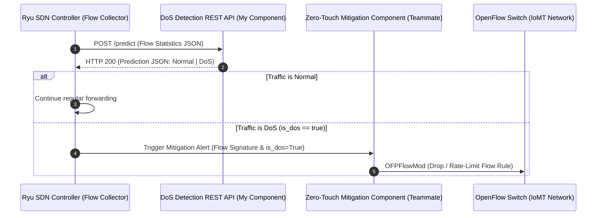

# SDN Mitigation Integration Contract & API Specification
**Project ID:** J26-CS-330  
**Individual Component:** DoS Detection via SDN Flow Analysis (IT23326354)  
**Consumer Component:** Zero-Touch Mitigation System (Team Member Component)  
**Document Version:** 1.0  
**Date:** 2026-10-13  

---

## 1. System Integration Boundary



### Strict Scope Delineation:
- **My Responsibility:** Ingest flow metadata, execute feature scaling/alignment, perform XGBoost inference, and return the detection verdict (`Normal` vs `DoS`), confidence probability, and latency metrics via HTTP REST API.
- **Teammate Responsibility:** Ingest the detection verdict from this API, decide on mitigation policy (e.g. drop rule, quarantine VLAN, dynamic bandwidth throttling), and install OpenFlow flow-modification entries (`OFPFlowMod`) to the SDN switches.

---

## 2. API Endpoint Specification

### Base URL:
`http://localhost:8000` (or `http://<CONTROLLER_IP>:8000`)

### Endpoint:
`POST /predict`

### Headers:
```http
Content-Type: application/json
Accept: application/json
```

---

## 3. Request Schema (JSON)

The API accepts OpenFlow 1.3 flow metadata or extracted statistical features. All fields are optional with standard default values `0.0` so that partial statistics still result in safe, continuous evaluation.

| Field Name | Type | Description | Example (Normal) | Example (DoS Flood) |
|---|---|---|---|---|
| `Duration` | float | Flow duration in seconds | `10.5` | `1.2` |
| `Rate` | float | Packet transmission rate (packets/sec) | `4.2` | `580000.0` |
| `Srate` | float | Source-to-destination packet rate | `4.2` | `580000.0` |
| `Drate` | float | Destination-to-source packet rate | `0.0` | `0.0` |
| `Protocol Type` | float | Protocol identifier (6=TCP, 17=UDP, 1=ICMP) | `6.0` | `17.0` |
| `Number` | float | Cumulative packet count in flow | `44.0` | `696000.0` |
| `Tot sum` | float | Cumulative bytes in flow | `2816.0` | `44544000.0` |
| `syn_flag_number` | float | 1.0 if SYN flag active, else 0.0 | `0.0` | `1.0` (SYN Flood) |
| `UDP` | float | 1.0 if UDP protocol, else 0.0 | `0.0` | `1.0` (UDP Flood) |
| `ICMP` | float | 1.0 if ICMP protocol, else 0.0 | `0.0` | `1.0` (ICMP Flood) |

---

## 4. Response Schema (JSON)

### HTTP 200 OK — Normal Traffic Example:
```json
{
  "prediction": "Normal",
  "is_dos": false,
  "confidence": 0.9982,
  "model_name": "XGBoost",
  "inference_latency_ms": 1.425,
  "timestamp": "2026-10-13T19:35:00.123456"
}
```

### HTTP 200 OK — DoS Attack Detected Example:
```json
{
  "prediction": "DoS",
  "is_dos": true,
  "confidence": 0.9995,
  "model_name": "XGBoost",
  "inference_latency_ms": 1.380,
  "timestamp": "2026-10-13T19:35:01.789012"
}
```

### Response Field Definitions for the Mitigation Developer:
- `prediction` (`string`): Categorical output, either `"Normal"` or `"DoS"`.
- `is_dos` (`boolean`): Direct boolean flag. If `true`, the mitigation engine must evaluate whether to install a block rule.
- `confidence` (`float`): True calibrated model posterior probability `[0.0, 1.0]`. You may enforce a mitigation safety threshold (e.g. only drop if `confidence > 0.95`).
- `inference_latency_ms` (`float`): Pure XGBoost inference duration for your performance accounting.
- `timestamp` (`string`): ISO-8601 UTC timestamp for mitigation audit logging.

---

## 5. Health Check Endpoint

### Endpoint:
`GET /health`

### Response:
```json
{
  "status": "ok",
  "model_loaded": true,
  "model_path": "models/xgboost_model.joblib",
  "feature_count": 45,
  "uptime_seconds": 124.50
}
```

---

## 6. How the Mitigation Component Developer Can Test This API

### Using cURL:
```bash
# Test Normal Flow:
curl -X POST "http://localhost:8000/predict" \
     -H "Content-Type: application/json" \
     -d '{"Duration": 15.0, "Rate": 2.0, "Protocol Type": 6.0, "TCP": 1.0, "Number": 30.0, "Tot sum": 1920.0}'

# Test DoS Flood Flow:
curl -X POST "http://localhost:8000/predict" \
     -H "Content-Type: application/json" \
     -d '{"Duration": 0.8, "Rate": 600000.0, "Protocol Type": 17.0, "UDP": 1.0, "Number": 480000.0, "Tot sum": 30720000.0}'
```

### Using Python `requests`:
```python
import requests

payload = {
    "Duration": 1.0,
    "Rate": 550000.0,
    "Protocol Type": 17.0,
    "UDP": 1.0,
    "Number": 550000.0,
    "Tot sum": 35200000.0,
}

response = requests.post("http://localhost:8000/predict", json=payload)
data = response.json()

if data.get("is_dos"):
    print(f"[ALERT] DoS Detected with confidence {data['confidence']:.4f}! Triggering zero-touch mitigation...")
    # Your mitigation logic here: controller.install_drop_rule(match)
else:
    print("[INFO] Normal traffic. No action taken.")
```
